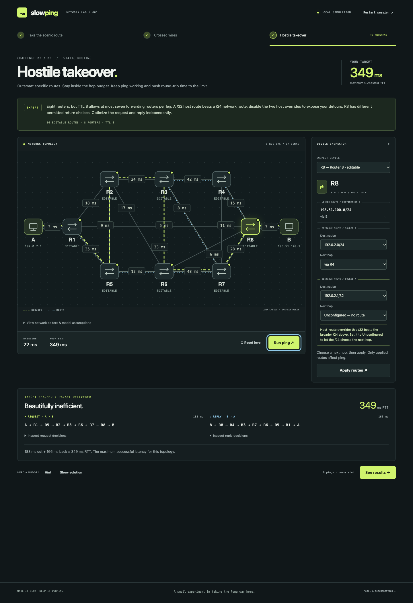

# Slow Ping

**Make the ping slow. Keep it working.**

A graphical static-routing puzzle. Each level begins with a functional network; change routes to maximize successful ping round-trip time. Inspect both directions, diagnose loops and missing routes, and learn how specific routes override broader ones.

**Status:** playable, verified static-only revision. The earlier MPLS-TE experiment has been retired from the game; its implementation remains in Git history.



## Play locally

Python3.11+ and a desktop browser are enough. No package installation, account, API key, backend, AI model, or runtime internet access is required.

```sh
python3 start.py
```

Open [http://127.0.0.1:8001](http://127.0.0.1:8001). Ctrl+C stops the server. Optional: `--port 8002` and `--no-browser`. The launcher serves this project directory even when invoked from elsewhere. From the NAF_AC6 workshop root:

```sh
python3 WORKSHOP/LAB/Examples/SlowPing/start.py
```

Static hosting can serve the repository root directly. Use HTTP; opening index.html with file:// does not support module/data loading. No public hosted deployment has been recorded.

## Difficulty progression

| Level | Routers | Editable routes | Baseline RTT | Maximum RTT | Challenge |
| --- | ---: | ---: | ---: | ---: | --- |
| Take the scenic route | 3 | 1 | 14ms | 59ms | One request detour, fixed return |
| Crossed wires | 6 | 10 | 22ms | 228ms | Weighted mesh; coordinate every request/return next hop |
| Hostile takeover | 8 | 16 | 22ms | 349ms | /32 overrides above /24 routes, restricted return choices, TTL budget |

Level2's maximum uses a114ms request and114ms reply. Level3 needs different forward and return paths:183+166=349ms. An eight-router reply could produce363ms total with a larger TTL, but fails with this game's TTL8. Each leg may use at most seven forwarding routers.

1. Read the level briefing and run a baseline ping.
2. Select a router on the diagram or from the inspector's selector.
3. Choose destination and next hop, then **Apply routes**. Unconfigured disables a route. The other-network prefix deliberately does not match the ping endpoints.
4. **Run ping** to see request/reply paths, delay sums and route decisions. Only a successful ping can improve your best RTT.
5. Reach the verified target to unlock Next. Hints and worked solutions remain available; assistance is shown separately.

The expert level's /32 host entries win over /24 network entries. Set the /32 entries to Unconfigured when you want their broader routes to take effect. The inspector explains each override and R3's permitted return choices.

Reset restores initial routes while retaining earned results. Confirmed session restart clears everything; cancel preserves it. Reload starts fresh. There is no timer or persistence.

All core actions work using keyboard with visible focus. Use native select navigation/type-ahead, Tab, Enter and buttons. **View network as text & model assumptions** lists every link; results list both paths. Crossing lines do not join unless a router is drawn. Reduced motion suppresses path animation without changing the score.

## Model and sources

The model uses static IPv4 routes with longest-prefix selection, logical endpoint gateways, fixed symmetric integer link delays and zero processing delay. A successful ping needs an Echo Request from A to B and an independently routed Echo Reply from B to A. RTT is the sum of traversed link delays, independent of animation duration.

Each packet starts at TTL8. A router decrements before forwarding and discards at zero; endpoints do not decrement. A loop is traced until expiry. Failures never earn latency scores. This model does not simulate ARP, interface subnet negotiation, packet loss, queueing, congestion, dynamic routing, Layer2 switching or live infrastructure.

| Source | Rule |
| --- | --- |
| [RFC1812§5.2.4](https://www.rfc-editor.org/rfc/rfc1812.html#section-5.2.4) | IPv4 route lookup; modeled longest-prefix subset |
| [RFC1812§5.3.1](https://www.rfc-editor.org/rfc/rfc1812.html#section-5.3.1) | Router TTL decrement and discard |
| [RFC792 Echo/Echo Reply](https://www.rfc-editor.org/rfc/rfc792.html) | Request/reply semantics |

Fixed delay, logical gateways, selected TTL8, permitted edits and restricted next hops are explicit teaching assumptions. Real devices include behavior this game omits.

## Verify and develop

Runtime uses native JavaScript modules, HTML, CSS, SVG and local JSON. Node20+ is only for development checks:

```sh
node --test tests/*.test.js
```

Browser checks use the pinned development-only Playwright dependency and Chrome:

```sh
npm ci
python3 start.py --no-browser
# In another terminal:
node tools/browser-check.mjs
```

CHROME_PATH overrides the macOS Chrome default; BASE_URL overrides the server URL. All20 domain/state/content checks and22 browser checks pass. Browser coverage includes a keyboard-only campaign, loop/TTL failure, /32 shadowing, asymmetric paths, reset/restart, reduced motion and375/760/1024/1440px layouts. This is not a full accessibility certification, screen-reader audit or cross-browser matrix.

[Current verification](docs/static-difficulty-verification.md) · [Domain TAP](docs/domain-results.tap) · [Browser JSON](docs/browser-results.json) · [Independent path proof](specs/003-static-difficulty/path-proof.json).

`python3 tools/author-levels.py` independently derives graph maxima and reproduces authored JSON using Python graph search. The separate JS oracle enumerates each router's local table choices and TTL-bounded simple paths; neither oracle uses the production ping evaluator for its expected maximum.

## Spec-driven build record

GitHub Spec Kit1.4.3.dev0, Codex integration. Workflow: constitution→specify→clarify→plan→tasks→analyze→implement. Working [constitution v1.1.0](.specify/memory/constitution.md); formal owner ratification remains pending.

- Active [specification](specs/003-static-difficulty/spec.md), [plan](specs/003-static-difficulty/plan.md), [tasks](specs/003-static-difficulty/tasks.md), [research/proof](specs/003-static-difficulty/research.md).
- Historical [MVP artifacts](specs/001-maximize-ping-latency/) and [retired TE experiment](specs/002-explicit-path-tunnel/).
- Workshop inputs in StarterKit/. Actual implementation status in implementation-status.json.

After reviewing the first MVP, the owner accepted an explicit-path experiment, then redirected the game toward static-only difficulty. The active campaign implements that direction. A research helper reviewed protocol boundaries during earlier planning; all current gameplay uses static routing.

## Credits and license

Created for Anthony House / [housepbass](https://github.com/housepbass). Workshop by John Capobianco, Joksan Flores, and Elliot Conner. Adapted from [NAF_AC6](https://github.com/automateyournetwork/NAF_AC6), the [Networking Video Game Starter Kit](https://github.com/automateyournetwork/NetworkingVideoGameStarterKit), and [GitHub Spec Kit](https://github.com/github/spec-kit).

[Apache-2.0](LICENSE). Code-authored SVG/CSS visuals; no external art or image generation.
