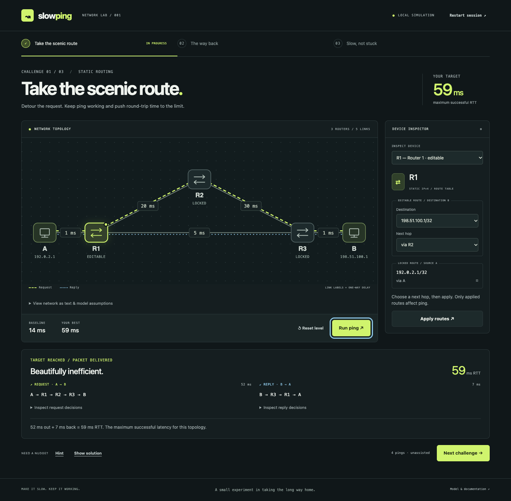

# Slow Ping

**Make the ping slow. Keep it working.**

A playable browser routing puzzle. Every challenge starts with a working network. Use the graphical router inspector to take a longer route, then send a ping and inspect its request and reply. Only a successful round trip counts.

**Status:** MVP implemented and locally verified; owner confirmation pending. Three levels, static IPv4 routing. Future protocols may begin immediately after owner confirmation.



## Play

Python 3.11+ and a desktop browser are enough; no install, API key, account or runtime internet required. From this repository's root:

```sh
python3 start.py
```

Open [http://127.0.0.1:8001](http://127.0.0.1:8001). Stop with Ctrl+C. Use `--port 8002` if busy; `--no-browser` suppresses automatic browser opening. The launcher serves this project directory even when invoked from elsewhere.

While this repo is nested in the workshop, run from the NAF_AC6 root:

```sh
python3 WORKSHOP/LAB/Examples/SlowPing/start.py
```

Use HTTP; opening index.html as a local file does not support module/data loading. Static hosting under a subpath is supported by relative URLs; no hosted demo has been published.

## How to play

1. Choose **Start here** and read the mission. Run a baseline ping.
2. Select a router on the canvas or with the Router selector. Editable routers have a green dot.
3. Choose a destination prefix and connected next hop, then **Apply routes**. Destination B is 198.51.100.1/32; source A is 192.0.2.1/32. The other prefix choice deliberately does not match either endpoint; Unconfigured disables the route.
4. **Run ping**. The solid network carries a dashed request and dotted reply. Read both ordered traces and their delay totals; expand the decisions for longest-prefix reasoning and TTL.
5. Reach the maximum target and move to the next challenge. A working but faster ping does not complete the challenge. Failed pings never improve the best RTT.

| Challenge | Baseline RTT | Maximum successful RTT | Lesson |
| --- | --- | --- | --- |
| Take the scenic route | 14 ms | 59 ms | Detour the request |
| The way back | 24 ms | 76 ms | The reply takes its own route |
| Slow, not stuck | 44 ms | 224 ms | Detour both legs; avoid loops |

Hints and worked solutions are available without penalty. Help is recorded separately from completion; after applying a solution you still run ping to verify it. Reset restores initial routes while retaining earned results. Restart asks for confirmation and clears everything. Reload starts a new session; there is no persistence or backend.

All core actions work with keyboard. Use Tab/Shift+Tab, Enter/Space on buttons, and native select navigation or type-ahead. **View network as text & model assumptions** provides the full text alternative. The page respects reduced motion; animation never changes scoring.

## Model and sources

This is a deterministic teaching model: logical routers, fixed endpoint gateways and direct-delivery routes, static IPv4 routes with longest-prefix selection, and fixed symmetric one-way link delays. RTT sums all links traversed by the request and reply. Router processing adds zero delay. There is no simulated loss, queueing, congestion, ARP, interface subnet negotiation, dynamic routing, or Layer 2 behavior.

Every request and reply starts with TTL 8. Each router decrements before forwarding; zero drops the packet. A loop is traced until TTL expires. TTL counts router forwarding steps in this model, not wall-clock milliseconds. ICMP error packets are not separately routed; the result directly explains a drop.

| Source | Supported rule |
| --- | --- |
| [RFC 1812 §5.2.4](https://www.rfc-editor.org/rfc/rfc1812.html#section-5.2.4) | IPv4 route lookup; model uses the longest-prefix subset |
| [RFC 1812 §5.3.1](https://www.rfc-editor.org/rfc/rfc1812.html#section-5.3.1) | Router TTL decrement and discard |
| [RFC 792, Echo or Echo Reply](https://www.rfc-editor.org/rfc/rfc792.html) | Echo request and returned reply |

Fixed link delays, logical endpoint attachments and TTL 8 are explicit game assumptions. Real network behavior and measured ping times include factors this game omits.

## Build and verify

Runtime: native JavaScript modules, HTML, CSS and SVG; original code and graphical elements, no runtime packages or external fonts. Developer tests require Node20+:

```sh
node --test tests/*.test.js
```

Browser checks require Chrome and the pinned development-only Playwright dependency:

```sh
npm ci
python3 start.py --no-browser
# In a second terminal:
node tools/browser-check.mjs
```

Set CHROME_PATH for another Chrome installation, BASE_URL for a different local server. Browser script defaults to macOS Chrome. See [verification evidence](docs/verification.md), [browser results](docs/browser-results.json), and [domain results](docs/domain-results.tap). These checks do not claim full accessibility certification or broad browser compatibility.

## Spec Kit artifacts

Completed workflow: constitution → specify → clarify → plan → tasks → analyze → implement.

- [Constitution v1.1.0](.specify/memory/constitution.md)
- [Feature specification](specs/001-maximize-ping-latency/spec.md)
- [Implementation plan](specs/001-maximize-ping-latency/plan.md), [research](specs/001-maximize-ping-latency/research.md), [data model](specs/001-maximize-ping-latency/data-model.md)
- [Tasks](specs/001-maximize-ping-latency/tasks.md) and [quickstart](specs/001-maximize-ping-latency/quickstart.md)
- Original workshop inputs: StarterKit/CONSTITUTION.md, StarterKit/SPEC.md, StarterKit/PLAN.md.

Specify CLI 1.4.3.dev0, upstream commit f56d514a6bec2d1cbcd3e33dc4387ca6178b4678; Codex integration. A research helper reviewed future protocol boundaries during planning. Implementation and evidence are tracked in implementation-status.json.

## After MVP confirmation

Static routing defines this first feature. EVPN, MPLS-TE, STP and other protocols can be scoped next without another waiting period. The static forwarding adapter is separate from topology, traversal, session state and rendering. These protocols are not implemented yet: MPLS needs label/path state; Layer 2 flooding and storms need packet replication, convergence and bounded event processing. They can extend the simulation while retaining the network map, explanation shell and successful-ping objective.

## Credits and license

Created for Anthony House / [housepbass](https://github.com/housepbass). Workshop by John Capobianco, Joksan Flores, and Elliot Conner. Adapted from [NAF AC6](https://github.com/automateyournetwork/NAF_AC6) and the [Networking Video Game Starter Kit](https://github.com/automateyournetwork/NetworkingVideoGameStarterKit), using [GitHub Spec Kit](https://github.com/github/spec-kit).

[Apache 2.0](LICENSE). No third-party art or model assets.
